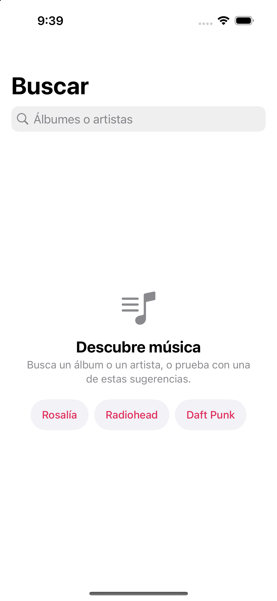

# iTunes Search

App iOS (SwiftUI, Swift 6, iOS 17, iPhone e iPad) para buscar álbumes y ver su detalle.



## API elegida

[iTunes Search API](https://developer.apple.com/library/archive/documentation/AudioVideo/Conceptual/iTuneSearchAPI/): pública, sin clave ni registro.

- Búsqueda: `https://itunes.apple.com/search?media=music&entity=album&term=<query>`
- Detalle: `https://itunes.apple.com/lookup?id=<id>&entity=song`

## Cómo ejecutarla

Requisitos: Xcode 16 o superior.

1. Abrir `iTunesSearch.xcodeproj`.
2. Elegir el esquema `iTunesSearch` y un simulador iPhone o iPad con iOS 17 o superior.
3. Run (`Cmd+R`).

Para probar sin depender de la API, lanzar con el argumento `-UITestMockData` (en el esquema: Edit Scheme > Run > Arguments): usa datos locales.

## Tests

```bash
# Domain y Data (rápidos, sin simulador)
cd Packages/SearchFeature && swift test --filter "DomainTests|DataTests"

# Todos los tests unitarios (plan iTunesSearch)
xcodebuild test -project iTunesSearch.xcodeproj -scheme iTunesSearch \
  -testPlan iTunesSearch -destination 'platform=iOS Simulator,name=iPhone 16'

# Tests de UI (plan iTunesSearchUITests); en iPad se ejecutan además los específicos de iPad
xcodebuild test -project iTunesSearch.xcodeproj -scheme iTunesSearch \
  -testPlan iTunesSearchUITests -destination 'platform=iOS Simulator,name=iPhone 16'
```

Los tests unitarios no usan red ni `sleep`: el reloj de la caché y el debounce se inyectan.

Los tests de UI (XCTest) arrancan la app con `-UITestMockData`, sin red. Cubren el flujo búsqueda → detalle → volver (también con texto grande), la auditoría de accesibilidad de Apple en búsqueda y detalle, y en iPad el detalle a dos columnas y el campo de búsqueda fijado bajo el título.

## Arquitectura

Paquete local `Packages/SearchFeature` con tres targets, cada uno con su target de tests:

| Capa | Contenido | Depende de |
|---|---|---|
| `Domain` | Entidades, protocolos de repositorio, casos de uso | nada |
| `Data` | Cliente HTTP, DTOs y mappers, repositorio, caché | `Domain` |
| `Presentation` | ViewModels y vistas SwiftUI | `Domain` |

`Presentation` no puede importar `Data`: el compilador lo impide. Quien conecta las capas es el composition root de la app (`App/CompositionRoot.swift`).

## Decisiones principales

**Cancelación.** `SearchViewModel` guarda la `Task` de la búsqueda en curso. Cada cambio de texto cancela la anterior antes de lanzar la nueva (con un debounce de 300 ms), y una tarea cancelada nunca escribe su resultado en el estado, aunque el caso de uso lo haya devuelto. Hay un test determinista que lo comprueba sin esperas reales.

**Caché.** Caché en memoria por query (normalizada), con TTL de 3 minutos, dentro de `Data`.
- Si hay una entrada válida, se devuelve sin llamar a la red.
- Si ha expirado, se pide a la red y se actualiza la caché.
- Es un `actor` para serializar accesos concurrentes y recibe el reloj por inyección, así los tests de expiración no esperan tiempo real.

**Estados de pantalla.** Inicial, cargando, vacío, error (con reintento) y resultados, modelados con un único `ViewState`.

**Accesibilidad y localización.** Dynamic Type hasta `accessibility5`, Reducir movimiento y VoiceOver; textos en español e inglés en un único String Catalog. La app no usa materiales ni transparencias, así que Reducir transparencia no tiene nada que adaptar.

**iPad y pantallas grandes.** El layout se decide por clases de tamaño, no por modelo de dispositivo. La lista mantiene un ancho de lectura cómodo y centrado; el detalle pasa a dos columnas (carátula a la izquierda, información y canciones a la derecha) con ancho regular y en el iPhone apaisado, y vuelve a una sola columna con tamaños de texto de accesibilidad. En iPad el campo de búsqueda se fija bajo el título en lugar de flotar arriba a la derecha.

## Fuera de alcance a propósito

El enunciado pide una app sencilla. Estas cosas se valoraron y se dejaron fuera:

- **Unificar peticiones idénticas en vuelo.** El view model cancela la búsqueda anterior en cada cambio y el debounce evita el solape, así que hay un solo consumidor. Compartir una tarea entre llamadas complicaría la cancelación: cancelar una podría cancelar la de otro.
- **Límite de tamaño de la caché.** Solo se purgan las entradas caducadas al insertar. Con memoria y un TTL de 3 minutos no crece de forma relevante durante una sesión.
- **Caché del detalle.** Se pide una vez por álbum; el enunciado habla de cachear la búsqueda.
- **Paginación.** La búsqueda pide 25 resultados y el enunciado no pide más.
- **Reintento automático y modo sin conexión.** Hay reintento manual desde la pantalla de error, pero no se reutiliza una caché caducada si falla la red.
- **CI.** Se construyó y se retiró por exceder el alcance. Los tests se ejecutan en local con los comandos de arriba.

## Limitaciones conocidas

- **iPhone Duo sin verificar.** Los layouts se basan en clases de tamaño y no se bloquea el redimensionado, así que debería funcionar, pero no se ha probado.
- **Multitarea del iPad** (Split View y Slide Over) sin revisar. El iPad se ha comprobado a mano y con tests de UI en vertical; el apaisado solo a mano.
- **La auditoría de accesibilidad exime dos avisos de controles del sistema** que la app no controla: el área pequeña del botón de borrar texto del campo de búsqueda y el veredicto límite "Contrast nearly passed" de los colores semánticos. Cualquier otro aviso hace fallar el test. La auditoría depende de la versión de iOS del simulador.
- **Precios en dólares.** La petición no envía `country`, así que los precios y el país son los de la tienda de EE. UU.
- **Sencillos como álbumes.** La API devuelve también sencillos y EPs dentro de `entity=album`; se muestran tal cual.
- **La carátula en alta resolución** se obtiene sustituyendo `100x100` por `600x600` en la URL de Apple, por lo que depende de ese formato de URL.
